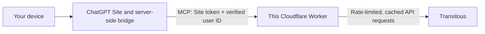

# Transitous MCP

A basic MCP shim for [Transitous](https://transitous.org/), exposing station
search, journey planning and departure boards to AI assistants.

The goal is to make it easier for more people to use public transport when travelling.
This is an independent project, not affiliated with or endorsed by Transitous.

**Transitous:** [Website](https://transitous.org/) ·
[Terms and usage policy](https://transitous.org/api/#usage-policy) ·
[Matrix chat](https://matrix.to/#/%23transitous:matrix.spline.de) ·
[GitHub](https://github.com/public-transport/transitous) ·
[Data sources and attribution](https://transitous.org/sources/)

## Tools

- `find_stations`: up to eight stop/place matches, IDs, coordinates and timezones.
- `plan_journey`: up to six alternatives, depart-after or arrive-by, optional
  direct routes and a transfer limit. Names resolve to coordinates; responses
  include alternative place matches to flag ambiguity.
- `station_departures`: up to twenty departures for a STOP ID from station lookup.

All time inputs require an ISO timestamp with an explicit UTC offset or `Z`,
e.g. `2026-10-10T08:00:00+01:00`. Time outputs retain the API's UTC timestamps
and place timezones where supplied. Interpret local dates using those timezones.
Arrival searches take the offset of the arrival deadline, not the origin.

Results include service names, operators, walking/coach legs, platforms,
cancellations and source/retrieval metadata where available. Geometry and
intermediate stops are omitted. Verify connections, check-in, fares, disruption
and availability with operators before travelling. No results does not prove
no service exists. See `transitous://guide` for research guidance.

## Hosting

Run locally with Wrangler (see [Develop and verify](#develop-and-verify)), or
deploy your own instance in your own Cloudflare account. Designed to fit within
Cloudflare Workers Free limits; this project does not provide a shared hosted
endpoint. See [PERFORMANCE.md](PERFORMANCE.md) for measurements and design choices.

## Before deploying

To follow [Transitous's usage policy](https://transitous.org/api/#usage-policy):

- Publish the code you deploy, including any changes, and keep the MIT licence
  notice. Light prototype testing before publication is fine.
- Keep your use of the Transitous API non-commercial.
- Contact Transitous in its [Matrix channel](https://matrix.to/#/%23transitous:matrix.spline.de)
  before routing or other potentially resource-intensive use. The limits below
  do not replace this requirement.
- Set `TRANSITOUS_USER_AGENT` with the application name, version and your own
  contact URL or email.
- Ensure your client visibly links to [Transitous sources](https://transitous.org/sources/)
  and credits [© OpenStreetMap contributors](https://www.openstreetmap.org/copyright).
  Follow any additional conditions from the data sources.

## Upstream load and caching

Transitous is an open, volunteer-run project providing shared public transport
infrastructure. We aim to respect its resources by keeping requests modest,
reusing cached results and avoiding bulk queries or automatic retries.

One SQLite Durable Object enforces these limits across all clients:

| Limit | Value |
|---|---|
| Upstream request spacing | At least 1 second |
| Upstream attempts | 30/minute; 200/UTC day |
| Active queue | 8 requests |
| Journey/station lookup cache | 24 hours |
| Departure board cache | 60 seconds |
| Cache storage | 64 responses, up to 1 MB each |

Failed attempts count; cache hits do not. At the daily limit, only cached
queries work until midnight UTC. Cached results retain their retrieval time
and report `cached: true`. Check boards or operators for current conditions.

Queries are bounded; bulk operations are unavailable. These limits protect
Transitous but do not cap Worker traffic or Cloudflare costs.

## Develop and verify

Node 20+ and a Cloudflare account with Workers/Durable Objects support.

```sh
npm ci
npm run check
```

`check` runs offline tests and a Wrangler dry-run bundle without calling
Transitous. Integration tests need a loopback port.

For local development, put a random `MCP_TOKEN` in an ignored `.dev.vars`, then
run `npm run dev`. Wrangler prints the endpoint. Keep credentials, real journey
outputs and caches out of version control.

Set `TRANSITOUS_MCP_URL` and `TRANSITOUS_MCP_TOKEN`, then run:

- `npm run smoke`: checks initialization, discovery, guide access and validation
  without upstream calls.
- `npm run smoke -- --live-lookup`: also checks one station lookup and its cache.

## Data and privacy

The shared cache can contain searched names and coordinates; host it in your
own Cloudflare account.
Worker observability is off by default, and errors omit raw upstream bodies.
Cloudflare may retain platform metadata.

## Deploy

All MCP connections require authentication. For direct clients:

1. Review `wrangler.jsonc`: Worker name and your public contact URL in
   `TRANSITOUS_USER_AGENT`. A source repository URL is preferable once published.
2. Authenticate Wrangler with `npx wrangler login` if required.
3. Set a random token with `npx wrangler secret put MCP_TOKEN` before deploying.
4. Run `npm run deploy`. Use the printed `https://…workers.dev/mcp` endpoint.

Missing or incorrect tokens return 401. With no token configured, `/mcp`
returns 503 without contacting upstream. Rotate or delete the secret with
Wrangler to change or close access.

The public `/` endpoint serves metadata. Browser CORS and legacy SSE are
unsupported; native Claude web/mobile installation is unverified.

## Connect clients

### ChatGPT via a Site

A separately hosted Site can bridge your device to this Worker. This repository
provides the Worker's authentication checks; the Site and its bridge are separate.
See [OpenAI's guide to building an MCP plugin with Sites](https://learn.chatgpt.com/docs/extend/mcp#build-an-mcp-plugin-with-plugin-creator-and-sites).



The Site handles ChatGPT login. Its trusted server-side bridge sends
`Authorization: Bearer <SITE_TOKEN>` and the verified user ID in
`Travel-Site-User`. Keep the token on the server; the bridge must derive the
user ID from the authenticated session.

Configure the Worker with:

```sh
npx wrangler secret put SITE_TOKEN
npx wrangler secret put ALLOWED_USER_IDS
```

`ALLOWED_USER_IDS` is a comma-separated list. Discovery requires the Site token;
tool calls and resource reads also require an allowlisted user (otherwise 403).
To find your user ID, make a refused call through the Site and inspect
`npx wrangler tail`.

`SITE_TOKEN` and the direct-client `MCP_TOKEN` can be configured independently.
If both are set, use distinct random values: identical tokens cause 503 to
prevent direct access bypassing the Site allowlist. For a Site-only deployment,
set the Site secrets instead of `MCP_TOKEN` in the deployment steps above.

### Desktop clients (including Claude Desktop)

Install dependencies locally and configure a standard stdio MCP entry using
absolute paths on that machine. For example:

```json
{
  "mcpServers": {
    "transitous": {
      "command": "/absolute/path/to/node",
      "args": ["/absolute/path/to/transitous_mcp/src/stdio.js"],
      "env": {
        "TRANSITOUS_MCP_URL": "https://YOUR-WORKER.workers.dev/mcp",
        "TRANSITOUS_MCP_TOKEN": "YOUR-SECRET-TOKEN"
      }
    }
  }
}
```

Use the Worker's `MCP_TOKEN` and keep the configuration private. HTTPS is
required except for loopback development. Desktop app installation still
needs a manual check.

### Claude Code and other HTTP clients

Connect Claude Code with the Worker token:

```sh
claude mcp add --transport http transitous https://YOUR-WORKER.workers.dev/mcp --header 'Authorization: Bearer YOUR-SECRET-TOKEN'
```

Keep the token in private client configuration. Other Streamable HTTP clients
can use the same URL.
See [Claude Code MCP documentation](https://code.claude.com/docs/en/mcp).

Try: “Find stations matching Fictional Town” or “Find the last connection
arriving before this timestamp”. Keep real journey data out of committed logs.

## Architecture

`mcp.js` defines the tools, `worker.js` handles authentication and HTTP transport,
and `stdio.js` bridges desktop clients to the Worker.

Upstream calls follow MOTIS 2.10.2: `v1/geocode`, `v6/plan` and `v6/stoptimes`.

References: [Cloudflare remote MCP guide](https://developers.cloudflare.com/agents/model-context-protocol/guides/remote-mcp-server/),
[MOTIS API schema](https://github.com/motis-project/motis/blob/v2.10.2/openapi.yaml).
